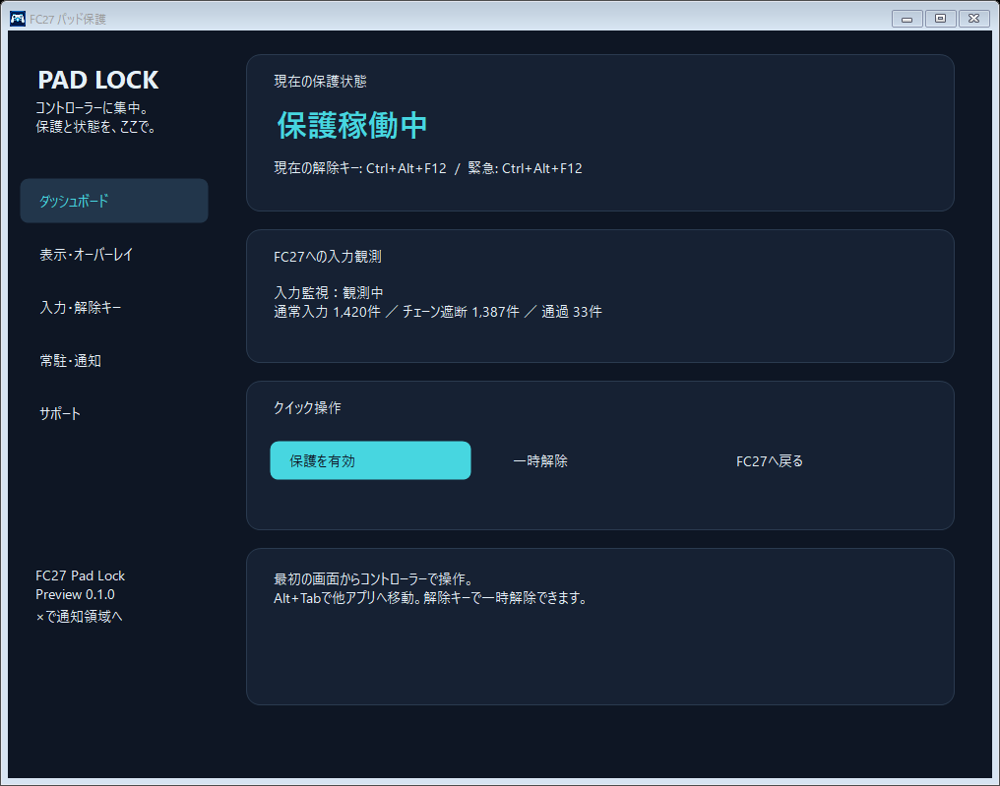
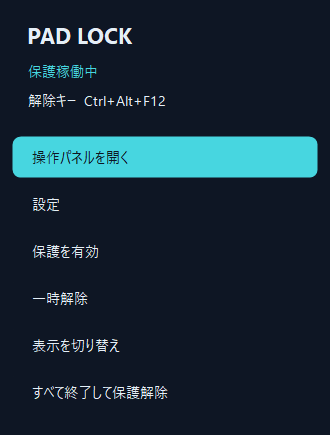

# FC27 Pad Lock

Windows版EA SPORTS FC 27で、コントローラーを使いたいときのキーボード・マウス入力を抑止する非公式ツールです。ゲームが前面の間だけ通常のキーボード入力・マウスクリック・スクロールなどを抑止し、Alt+Tabで他アプリへ移動すると通常入力を使えます。

通知領域に常駐し、専用アプリアイコン、状態ダッシュボード、右クリックのクイックパネル、ゲーム画面の隅のオーバーレイを備えています。日本語・英語、ダーク・ライト・Windows連動テーマ、自動起動、通知、解除キー、オーバーレイの位置・大きさ・不透明度・表示項目をアプリ内で設定できます。オーバーレイはクリックを受けず、操作フォーカスを奪わない外部ウィンドウです。

**初回公開版は `v0.1.0-preview.1` です。** 実機確認済みの範囲はWindows上のSteam版FC27、USB接続のDualSense Edge、メニュー操作です。全コントローラーや全試合条件での入力切り替え防止を確認したリリースではありません。

## ダウンロード

[GitHub Releases](https://github.com/anyscape-maruo/fc27-pad-lock/releases)から `FC27PadLockSetup.exe` をダウンロードして実行します。管理者権限不要でユーザー専用にインストールできます。ポータブル版は `FC27PadLock-v0.1.0-preview.1-win-x64.zip` をすべて展開してください。GitHubの「Source code」ZIPには実行ファイルが含まれません。

## すぐ使う

1. ZIPを全部展開し、普段使う場所にフォルダーを置きます。
2. `Start.cmd` をダブルクリックします。
3. 操作パネルの「保護を有効」を押します。最初は「30秒試験」でも確認できます。
4. Steam版なら「FC27を起動」を押し、ゲームの最初の画面からコントローラーで操作します。
5. Discordなどへ移るときは **Alt+Tab**。保護を一時解除するときは **Ctrl+Alt+F12**。

パネルの×はパネルを隠します。全終了は通知領域のアイコンを右クリックし、全終了の操作を選びます。常駐の自動起動はインストーラーまたはアプリの常駐設定から選べます。

マウスカーソルが動いて見える場合があります。実機のメニュー試験では、カーソルが動いてもクリックは抑止されました。表示だけで判断せず、実際の選択・決定や選手操作を確認してください。

## 資料

- [利用マニュアル](docs/MANUAL.ja.md)：導入、通常操作、自動起動、終了、更新、削除。
- [トラブル対処](docs/TROUBLESHOOTING.ja.md)：入力できない、起動できない、保護が効かないとき。
- [対応状況](docs/COMPATIBILITY.ja.md)：確認済み環境と未確認の組み合わせ。
- [プライバシー](docs/PRIVACY.ja.md)：保存する情報と保存しない情報。
- [オーバーレイ](docs/OVERLAY.ja.md)：表示、非表示、位置、単独の常駐。
- [アプリ設定](docs/SETTINGS.ja.md) / [Settings in English](docs/SETTINGS.en.md)：テーマ、常駐・通知、表示・解除キー、拡張。
- [エラー報告](docs/REPORTING.ja.md)：診断ZIPの保存とGitHubへの添付。
- [English manual](docs/MANUAL.en.md)：導入と操作の英語版。
- [開発・検証](docs/DEVELOPMENT.ja.md)：ビルド、自己テスト、公開物の作成。
- [更新履歴](CHANGELOG.md)、[変更提案](CONTRIBUTING.md)、[セキュリティ情報](SECURITY.md)。

## 制限

Windowsの低レベルキーボード・マウスフックを使います。Raw Inputを含むすべての入力経路の遮断は保証しません。注入入力は通すため、リマップソフトなどの入力が残る場合があります。フックの登録状態は表示しますが、Windowsによるフックの無通知解除まで検知できません。[MicrosoftのAPI説明](https://learn.microsoft.com/en-us/windows/win32/winmsg/lowlevelkeyboardproc)も参照してください。

ゲームの入力設定・セーブ・Steamのコントローラー設定を書き換えません。ドライバーの追加、ゲームプロセスへのコード注入、ゲームメモリーの読み取り、入力の自動送信も行いません。EA・Valve・Sony等の公式製品ではなく、これらの企業による承認や全環境での互換性を示すものではありません。

実行ファイルにコード署名は付いていません。配布物のSHA256は各Releaseの `SHA256SUMS.txt` にあります。

## ライセンス

[MIT](LICENSE)。著作権表示・ライセンス本文を残す条件で利用・改変・再配布・商用利用ができます。

## English overview

An unofficial Windows x64 input guard for EA SPORTS FC 27. It suppresses ordinary low-level keyboard/mouse events while FC27 is foreground, without modifying game files or controller configuration. Alt+Tab remains available; Ctrl+Alt+F12 toggles protection. Controller hardware is not filtered. The observed setup is Steam FC27 with a USB DualSense Edge in menus; other controllers and match conditions remain unverified. Raw Input and injected input are not fully blocked. This preview is unsigned and licensed under MIT. Download the executable ZIP from Releases; source archives need a local build.
